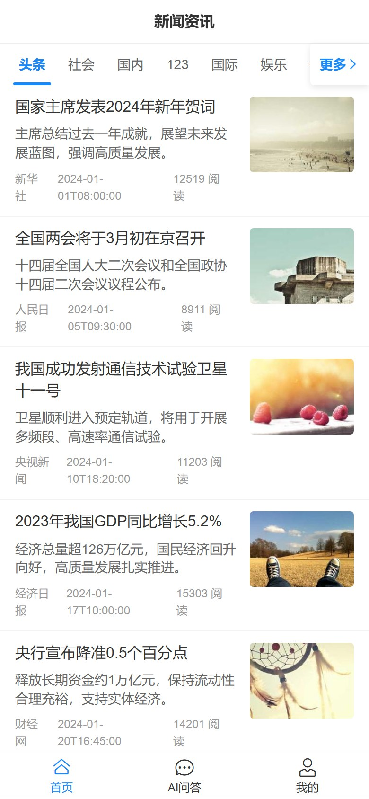
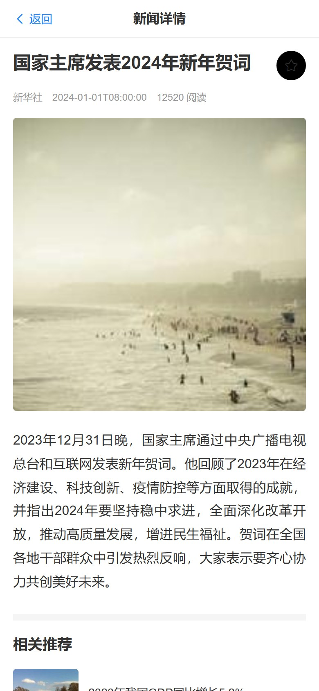
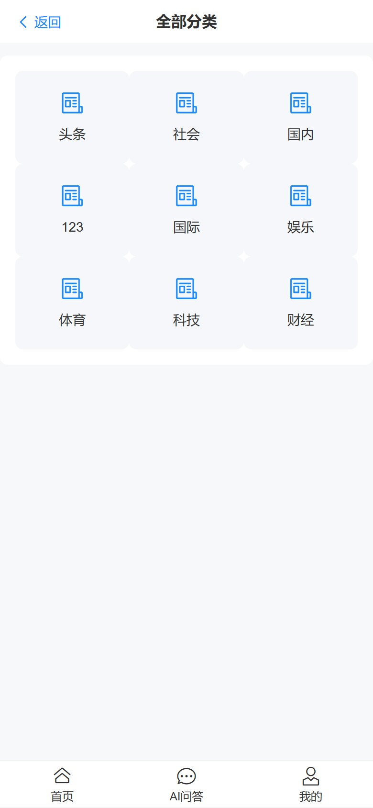
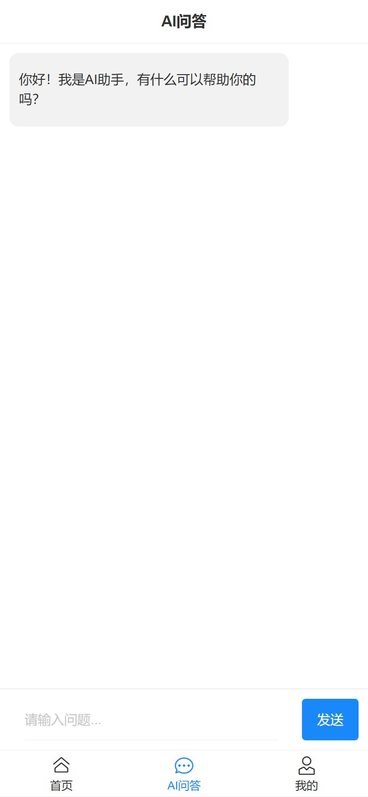
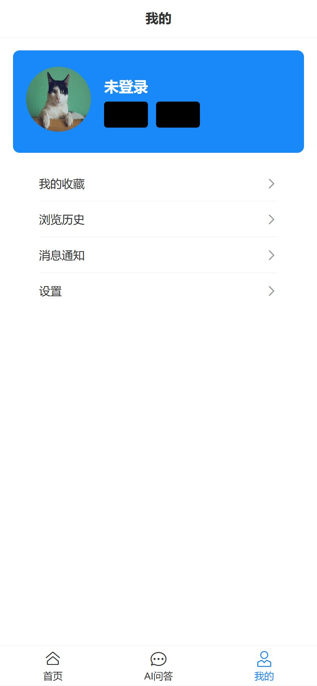
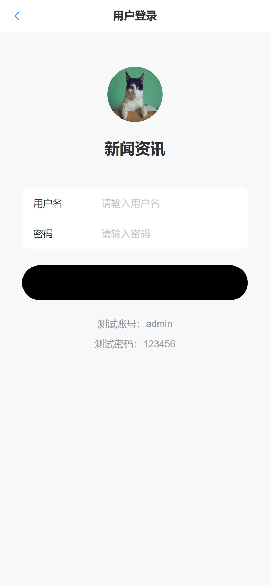

# AI掘金头条

一个「AI + 新闻资讯」练手项目：**FastAPI 后端 + Vue 3 移动端前台**，包含新闻分类、搜索、收藏、浏览历史、用户登录注册与 Redis 缓存。

## 目录结构

```text
AI-juejin-news/
├─ toutiao_backend/            # Python FastAPI 后端（SQLAlchemy + MySQL + Redis）
├─ xwzx-news/                  # Vue 3 + Vite 移动端前台（Vant 4 + Pinia）
├─ database.sql                # MySQL 建库建表 + 示例数据
├─ API接口规范文档.md
├─ 项目后端设计说明文档.md
└─ 第六章_AI掘金头条-缓存和调用模型.pdf
```

## 技术栈

| 端 | 技术 |
| --- | --- |
| 后端 | Python 3.13、FastAPI、SQLAlchemy（async）、aiomysql、Redis、JWT |
| 前端 | Vue 3、Vite 7、Pinia、Vue Router、Vant 4、Axios、marked + DOMPurify |

## 界面预览

移动端页面截图（390 × 844 视口，使用 `database.sql` 里的示例数据）：

| 首页 | 新闻详情 | 分类 |
| --- | --- | --- |
|  |  |  |
| **AI 问答** | **我的** | **登录** |
|  |  |  |

## 快速开始

### 1. 初始化数据库

需要 MySQL 8，导入建库脚本：

```bash
mysql -u root -p < database.sql
```

脚本会自动创建 `news_app` 数据库、表结构和示例数据。

### 2. 启动后端

需要 Redis（默认 `localhost:6379`）。

```bash
cd toutiao_backend
python -m venv .venv
# Windows
.venv\Scripts\activate
# macOS / Linux
source .venv/bin/activate

pip install -r requirements.txt
uvicorn main:app --reload --port 8000
```

数据库和 Redis 的连接在 `config/db_config.py`、`config/redis_config.py`，默认是本机 `root/123456`，部署前请改成自己的配置。

### 3. 启动前端

```bash
cd xwzx-news
npm install
npm run dev
```

前端请求地址在 `xwzx-news/src/config/api.js`，默认指向 `http://127.0.0.1:8000`。

「AI 问答」需要模型 Key：在 `xwzx-news/.env` 里写 `VITE_AI_API_KEY=你的Key`，不要提交到仓库（未配置时页面会提示填写）。

## 文档

- [API接口规范文档.md](API接口规范文档.md)
- [项目后端设计说明文档.md](项目后端设计说明文档.md)
- 《第六章_AI掘金头条-缓存和调用模型.pdf》

## 说明

- 仓库不包含 `.venv`、`node_modules`、`__pycache__` 等依赖和缓存目录，克隆后按上面的步骤安装。
- 后端数据库密码、Redis 地址为本地演示默认值，仅用于练手。
